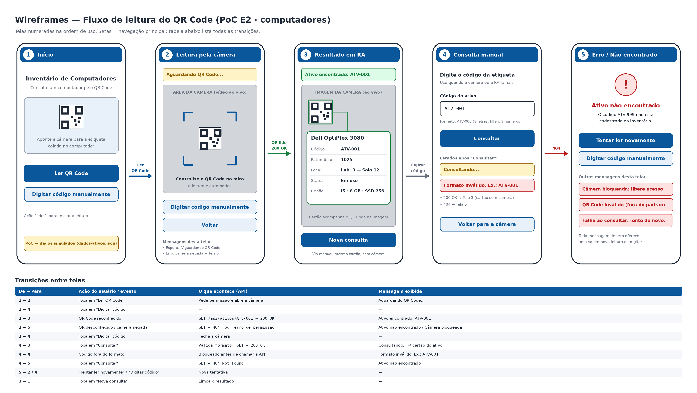

# 3.4 Wireframes e critérios de UX

Rascunho das telas da PoC de leitura de QR Code para **computadores** do inventário.
As imagens estão nesta pasta e seguem a ordem de uso.

| Arquivo | Tela |
|---|---|
| [00-fluxo-completo.png](00-fluxo-completo.png) | Visão geral: as 5 telas + tabela de transições |
| [01-inicio.png](01-inicio.png) | 1. Início |
| [02-leitura-camera.png](02-leitura-camera.png) | 2. Leitura pela câmera |
| [03-resultado-ra.png](03-resultado-ra.png) | 3. Resultado em RA |
| [04-consulta-manual.png](04-consulta-manual.png) | 4. Consulta manual (alternativa) |
| [05-erro.png](05-erro.png) | 5. Erro / ativo não encontrado |



## Sequência do fluxo

```
1 Início ──Ler QR Code──► 2 Câmera ──QR lido / 200 OK──► 3 Resultado em RA ──Nova consulta──► 1
   │                         │  └──404 / câmera negada──► 5 Erro ──Tentar novamente──► 2
   └──Digitar código──► 4 Consulta manual ──200 OK──► 3          └──Digitar código──► 4
                              └──404──► 5
```

## Descrição das telas

**1. Início** — título do app, botão principal **Ler QR Code** e botão secundário **Digitar código manualmente**. Aviso de que a PoC usa dados simulados (`dados/ativos.json`).

**2. Leitura pela câmera** — vídeo ao vivo com uma mira; a leitura é automática ao centralizar o QR Code. Mensagem de espera **"Aguardando QR Code..."**. Botões **Digitar código manualmente** e **Voltar**.

**3. Resultado em RA** — a imagem da câmera continua visível; o QR Code reconhecido ganha uma moldura verde e um cartão é desenhado **sobre a imagem**, ligado ao marcador. Mensagem de sucesso **"Ativo encontrado: ATV-001"**. Quando a consulta vem da tela 4, o mesmo cartão aparece sem a câmera.

Informações exibidas do computador (mínimo exigido: 3):

| Campo | Exemplo |
|---|---|
| Nome / modelo | Dell OptiPlex 3080 |
| Código (lido no QR) | ATV-001 |
| Patrimônio | 1025 |
| Localização | Lab. 3 — Sala 12 |
| Status | Em uso |
| Configuração | i5 · 8 GB · SSD 256 |

**4. Consulta manual** — campo **Código do ativo** com dica do formato `ATV-000` e botão **Consultar**. Estados: **"Consultando..."** (espera) e **"Formato inválido. Ex.: ATV-001"** (erro tratado antes de chamar a API).

**5. Erro** — mensagem clara com o código que falhou e duas saídas: **Tentar ler novamente** (volta à tela 2) e **Digitar código manualmente** (vai à tela 4). Outras mensagens possíveis: câmera bloqueada, QR Code fora do padrão e falha na consulta.

## Mensagens previstas

| Tipo | Mensagem | Onde |
|---|---|---|
| Espera | Aguardando QR Code... | Tela 2 |
| Espera | Consultando... | Tela 4 |
| Sucesso | Ativo encontrado: ATV-001 | Tela 3 |
| Erro | Ativo não encontrado (404) | Tela 5 |
| Erro | Câmera bloqueada: libere acesso | Tela 5 |
| Erro | QR Code inválido (fora do padrão) | Tela 5 |
| Erro | Formato inválido. Ex.: ATV-001 | Tela 4 |
| Erro | Falha ao consultar. Tente de novo. | Tela 5 |

## Critérios de UX verificáveis

1. O usuário inicia uma leitura em **1 ação** (tocar em "Ler QR Code") a partir da tela inicial.
2. A consulta manual fica acessível em **no máximo 1 toque** a partir das telas 1, 2 e 5.
3. O resultado mostra **pelo menos 3 informações** do computador (a PoC mostra 6).
4. Toda tela de erro oferece **pelo menos 2 saídas** (nova leitura ou digitar o código); o usuário nunca fica sem ação.
5. Toda ação que depende de espera (câmera abrindo, consulta à API) exibe uma **mensagem de espera** visível.
6. Código digitado fora do formato `ATV-000` é recusado **antes** de chamar a API, com exemplo do formato correto.
7. O usuário volta ao início em **1 toque** após ver o resultado ("Nova consulta").

## Coerência com as outras entregas

- O identificador `codigo` (ex.: `ATV-001`) é o mesmo do QR Code, do modelo de dados e da rota `GET /api/ativos/{codigo}`.
- Os campos do cartão (nome, patrimônio, localização, status, configuração) precisam existir em `dados/ativos.json` e em `docs/modelo-dados`.
- A validação de formato (tela 4) e o tratamento de QR inválido (tela 5) correspondem aos controles descritos em `docs/seguranca.md`.
